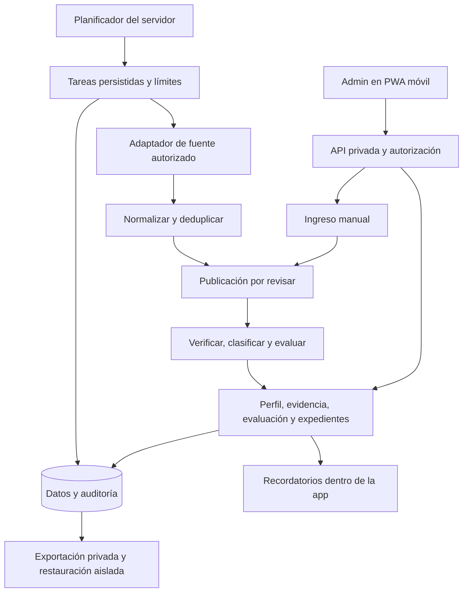
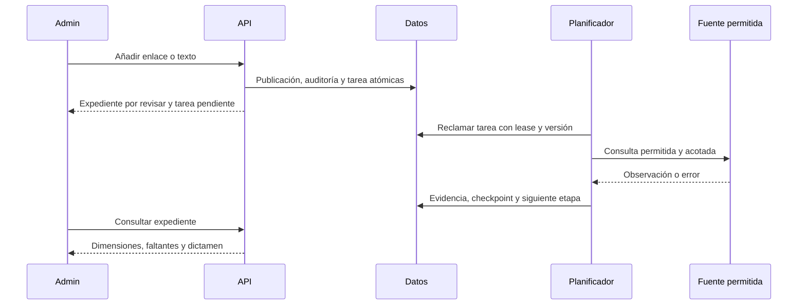
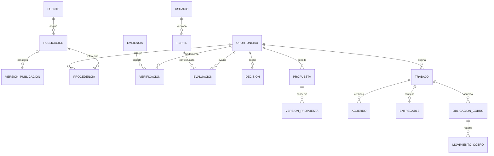

# NAOFUMI — Especificación de arquitectura en Lápiz

Versión 0.1 · 2026-10-19 · Responsable de decisiones: Admin / Atátoriz · Redacción: Codex.

**Estado: borrador documental para revisión. No aprobado para implementación.** La autorización vigente comprende investigación de lectura y diseño. No se ha creado código de producto, repositorio, rama, infraestructura, integración ni automatización. MARTILLO deberá identificar explícitamente el bloque y alcance autorizados. Aprobar este documento no equivale a MARTILLO.

## 1. Lecturas, autoridad y límites de esta entrega

Se leyeron el encargo local `NAOFUMI_ENCARGO_ESTRICTO_CODEX_V01.md`, el [reporte maestro vigente](https://docs.google.com/document/d/1CDpLkYtBqrZUcyqX5-dhw4tsRFSLwJ-3O5v_wHBBcAw/edit) y la [copia Markdown maestra](https://drive.google.com/file/d/1gylFjUgdR6NxFV-B7LdfiiwfbHiKJ4te/view). Se listó la [carpeta autorizada de Gastón](https://drive.google.com/drive/folders/10tyNoc_jFLr1VCu2JALVOibG_HKdWJ9A) y se descargó e inspeccionó la [referencia visual elegida](https://drive.google.com/file/d/1vdOFLUxn16BDTh9d1BaYgqsFY7CqSSG9/view). Los maestros se identifican como versión 0.2 y sus metadatos indican modificación el 2026-10-19. No se inspeccionaron las otras seis láminas; las observaciones históricas sobre ellas proceden de los maestros.

No se inspeccionaron repositorios, cuentas de infraestructura, capacidades profesionales de Admin, saldos, oportunidades reales ni automatizaciones anteriores. No hay repositorio de NAOFUMI verificado. La documentación pública se consultó el **2026-10-19 UTC**; describe lo publicado, no acceso concedido a una futura app. No se ejecutaron pruebas de conectores, rendimiento, seguridad, interfaz o restauración.

### 1.1 Discrepancias reales y tratamiento

| Evidencia | Discrepancia o ambigüedad | Tratamiento en este borrador |
|---|---|---|
| Maestro, §§10 y 12 frente a §§15–17 | El texto antiguo dice estilo pendiente y escudo; la consolidación declara elección de Tablón con paleta Escudo explorador | La consolidación explícita y el encargo coinciden: elección visual cerrada; no reabrirla |
| Maestro, §10 frente a §17 | Perfil en barra inferior frente a Hoy y perfil en avatar | La segunda es propuesta posterior, todavía no decisión de Admin; se recomienda y se deja pendiente D01 |
| Maestro, §8 frente al encargo, §10 | Un flujo narrativo reúne propuesta, ejecución y cobro | Se especifican cuatro máquinas independientes, como exige el encargo; no inferir cobro por entrega |
| Maestro, §6 | Incluye eliminadas entre descartes | Un 404 o inaccesibilidad aislados no prueban cierre: acceso inaccesible y apertura sin confirmar; conservar expediente |
| Lámina elegida | Una oportunidad «Guardada» aparece dentro de la pestaña Propuestas | Guardada pertenece a oportunidad; no crear propuesta implícita. Distinguir vistas dentro de Misiones |
| Lámina elegida | La tarjeta de nueva misión carece de revisión, presupuesto y costo; gran ilustración inicial | Es referencia conceptual. Añadir campos y reducir imagen sin alterar identidad |
| Encargo: presupuesto cero y evaluación de connects | No define si se pueden consumir connects ya disponibles | Diseñar ledger; no autorizar gasto. D04 debe cerrar tratamiento del saldo existente |
| No borrar y cuotas finitas | Archivar conserva datos y no libera almacenamiento | Limitar admisión, detener captura y exportar; nunca purgar o ampliar plan automáticamente |

No se detectó contradicción de fondo entre el encargo y la consolidación vigente de los maestros. Las condiciones de fuentes que requieren aclaración se registran en §5; no se resuelven por suposición.

### 1.2 Convenciones de autoridad

- **E — Exigido/elegido:** decisión expresa del encargo o consolidación de Admin.
- **R — Recomendación:** diseño de Codex para revisión; no decisión atribuida a Admin.
- **P — Pendiente:** alternativas, bloqueo y pregunta en §13.
- **V — Verificado documentalmente:** observado en una referencia consultada; no implica prueba operativa.

Salvo lo marcado E o V, los detalles técnicos, nombres, umbrales y contratos de este documento son propuestas R. No existen datos comerciales de ejemplo presentados como reales.

## 2. Producto y alcance

**Objetivo E:** una app personal para celular que reduzca tiempo de revisión y convierta oportunidades aprovechables en seguimiento efectivo hasta entrega y cobro. Dos circuitos: Tablón, para necesidades expresadas; Exploración, para hipótesis de mejoras. Ningún sector profesional queda validado sin evidencia del perfil.

Dentro del diseño: acceso privado, capacidades y portafolio, ingreso manual, inventario de fuentes, evidencia multidimensional, reglas explicables, decisiones, propuestas versionadas, ejecución, costos y cobros, recordatorios internos, auditoría y exportación. Excel, dashboards, automatización, investigación, documentación, redacción, edición y gestión son áreas a evaluar, no habilidades adjudicadas.

Fuera de primera implementación propuesta: correo, push, envío de propuestas o mensajes desde NAOFUMI, compras, pagos, gasto automático de connects, adjuntos alojados, edición offline, navegación automatizada pesada, IA obligatoria, modelos locales obligatorios, multicuenta y producto público. No se incluye modificar RACOON, ATLAS, COPOX ni infraestructuras existentes.

Éxito a medir tras uso real: oportunidades admitidas que Admin considera aprovechables / oportunidades revisadas; tiempo de revisión por expediente; seguimientos completados / vencidos; propuestas y resultados efectivamente registrados. Sin muestra etiquetada no declarar precisión, probabilidad de contratación ni ausencia de fraude.

## 3. Arquitectura propuesta y viabilidad

### 3.1 Estructura

Monolito modular E, con adaptadores desacoplados dentro del mismo despliegue lógico. R: PWA React + TypeScript + Vite; API HTTP y planificador en Cloudflare Workers; repositorios sobre D1; SQL y formatos de exportación portables a SQLite. Un mismo origen para interfaz/API simplifica sesiones y CSRF. Los adaptadores no escriben directamente expedientes: entregan observaciones al pipeline.

El teléfono inicia consultas y registra decisiones. El servidor conserva tareas antes de responder. Cerrar la app no cancela trabajos persistidos. No se confía en temporizadores del navegador ni en prolongar una petición HTTP para sostener el pipeline.

### 3.2 Cuotas publicadas y consecuencias

Consulta V: 2026-10-19. No se verificó un plan contratado ni capacidad libre en una cuenta real. Las cuotas son de proveedor; los presupuestos internos propuestos son independientes.

| Recurso | Condición gratuita documentada | Consecuencia de diseño |
|---|---|---|
| Workers | 100 000 solicitudes/día y 10 ms CPU por invocación; assets estáticos gratuitos según modalidad de servicio | API y etapas pequeñas. No prometer parsers pesados; medir CPU antes de aprobar recolectores. [Precios](https://developers.cloudflare.com/workers/platform/pricing/) |
| Workers | 128 MB de memoria, 50 subsolicitudes por petición, 5 Cron Triggers por cuenta | Un despachador para fuentes/tareas; no un cron por fuente. [Límites](https://developers.cloudflare.com/workers/platform/limits/) |
| D1 | 5 millones de filas leídas/día, 100 000 escritas/día, 5 GB totales; al agotar lecturas/escrituras rechaza consultas; reinicio diario 00:00 UTC | Índices y contabilidad; reservar margen, pausar captura. Si la base no responde, informar indisponibilidad sin prometer escritura. [Precios](https://developers.cloudflare.com/d1/platform/pricing/) |
| D1 | 500 MB por base Free, 10 bases por cuenta, 50 consultas por invocación; Time Travel Free de 7 días | Diseñar una base pequeña; 5 GB de cuenta no equivalen a 5 GB en esa base. [Límites](https://developers.cloudflare.com/d1/platform/limits/) |

La existencia de un plan gratuito no demuestra que un alta particular pueda completarse sin facturación. Antes de aprovisionar, B01 deberá verificar que no requiere tarjeta, facturación obligatoria ni plan pago; si lo exige, detener esa alternativa. No utilizar recursos compartidos de los otros proyectos.

R: alerta al 70% y pausa de captura al 85% del presupuesto interno asignado, con reserva para interacción y exportación; valores sujetos a D06. Registrar consumo observado y hora, no un contador ficticio de toda la cuenta. Sin lectura fiable del consumo, usar presupuestos conservadores y marcar medición incompleta. El límite del proveedor sigue siendo la última barrera; no autorizar ampliación automática. Si la infraestructura no puede servir ni el aviso, el shell local debe decir «No se pudo consultar el servidor», sin inventar la causa.

### 3.3 Alternativas y salida del proveedor

| Opción | Ventaja | Costo/dependencia o límite | Recomendación |
|---|---|---|---|
| Workers + D1 + assets | Servidor independiente del celular; piezas limitadas | Runtime y administración de proveedor; CPU estrecha, almacenamiento finito | Candidata principal, condicionada a B01 y consumo B04 |
| API portable + SQLite en equipo propio | Control y portabilidad; sin licencia de servidor propietaria necesaria | Equipo encendido, energía, red, TLS y mantenimiento no acreditados | Alternativa si Admin aporta equipo y acepta operación; no asumir disponibilidad |
| PWA solo local | Infraestructura mínima | Sin recolección persistente de servidor; riesgo de pérdida local | Modo manual reducido, no cumple por sí solo el objetivo completo |
| Otro alojamiento gratuito | Posible mejor CPU o tareas | Cuotas, suspensión, tarjeta y persistencia no investigadas | No declarar viable o gratis; estudio separado si falla principal |

R: capa de dominio sin bindings de Cloudflare; interfaces de almacenamiento, reloj, identidad y recuperación HTTP; SQL conservador; migraciones versionadas; exportación JSONL y SQL portable. D1 no equivale a archivo SQLite descargable directo: verificar reconstrucción a partir del export. Separar el adaptador de D1 del dominio y no exponer su API al cliente.

### 3.4 Licencias y dependencias

V: [React MIT](https://raw.githubusercontent.com/facebook/react/main/LICENSE), [Vite MIT](https://raw.githubusercontent.com/vitejs/vite/main/LICENSE), [TypeScript Apache-2.0](https://raw.githubusercontent.com/microsoft/TypeScript/main/LICENSE.txt), [SQLite de dominio público](https://www.sqlite.org/copyright.html). Son condiciones de proyectos upstream consultados, no inventario auditado de versiones instaladas: no se instalaron dependencias. B01 deberá fijar versiones, conservar avisos y revisar dependencias transitivas.

Workers, D1, Google Identity y las fuentes externas son servicios de proveedores; su nivel gratuito no los convierte en software libre. No usar R2, colas externas, plataformas de IA ni bibliotecas adicionales por disponibilidad incidental. Elegir cada dependencia y comprobar licencia/costo antes de incorporarla.

## 4. Responsabilidades por módulo

Cada fila define propietario de datos. Las operaciones atraviesan autorización, validación e idempotencia; las escrituras relacionadas deben confirmar en una unidad atómica o reanudable explícita.

| Módulo | Entrada → salida / operaciones | Datos propios | Errores y dependencias |
|---|---|---|---|
| Acceso | Identidad verificada → sesión; entrar, revocar, salir | Usuario, sesión, intento de acceso | Identidad ajena, nonce inválido, expiración; proveedor OIDC |
| Perfil/capacidades | Evidencias y declaraciones → perfil versionado; añadir, revisar, archivar | Perfil, capacidad, evidencia de capacidad, servicio, portafolio | Evidencia ausente o inaccesible no valida; acceso y auditoría |
| Fuentes | Condiciones y permisos → inventario; registrar, pausar, revisar permiso | Fuente y revisiones de condiciones | Permiso insuficiente, cuota desconocida; acceso |
| Recolección | Fuente habilitada y cursor → observaciones; descubrir, detalle, revalidar | Ejecución, tarea y cursor | 401/403/CAPTCHA pausa; 429 espera; red/5xx reintentos; fuentes, recuperador seguro |
| Normalización | Observación → publicación tipada, relación de procedencia | Publicación, versión, procedencia, coincidencia sugerida | Fecha ambigua, esquema cambiado, duplicado conflictivo; fuentes |
| Verificación | Hecho + evidencia → dimensión revisada; constatar, contradecir, caducar | Evidencia, verificación | Original inaccesible, evidencia contradictoria; normalización |
| Evaluación | Perfil, requisitos, verificaciones y reglas → motivos y dictamen | Requisito, reglas, evaluación y decisión separada | Esencial desconocido, regla sin aprobar, cambio de perfil; verificación/perfil |
| Propuestas | Oportunidad y decisión → borrador/versión/actividad; registrar envío externo | Propuesta, versión, actividad | Falta de alcance, registro inconsistente; no envío desde módulo |
| Ejecución | Acuerdo confirmado → trabajo, entregables y revisiones | Trabajo, versiones de acuerdo, entregable/revisión | Cambio sin aceptar, entrega sin referencia; propuestas |
| Costos/cobros/connects | Hechos económicos → movimientos y saldo derivado | Cuenta connects, movimiento, costo, obligación de cobro y movimiento | Saldo desconocido, moneda distinta, duplicado; auditoría |
| Recordatorios | Siguiente acción y fecha → aviso interno; posponer, completar, cancelar | Acción y recordatorio | Entidad resuelta, fecha sin zona, duplicado; expedientes |
| Auditoría | Mutación/decisión → evento mínimo inmutable | Evento con actor, motivo y correlación | No guardar secretos; escritura junto al cambio, sin borrar historial |
| Exportación/recuperación | Solicitud privada → snapshot y manifiesto; validar/restaurar aislado | Exportación, resultado de restauración | Cuota, formato/versión inválidos, integridad; todos los módulos |

## 5. Matriz inicial de fuentes investigadas

**Fecha común de consulta: 2026-10-19.** Ningún recolector existe ni fue probado. Para todas: `ultima_consulta_operativa_exitosa = null`, `fallo_operativo_actual = null`, `estado_operativo = no_configurada`; no confundir este estado con fuente caída. Lectura de documentos no cuenta como consulta de oportunidades.

| Fuente y utilidad posible | Modalidad inicial recomendada | Acceso, costo y condiciones comprobadas | Frecuencia/límites y bloqueo |
|---|---|---|---|
| Upwork: encargos freelance y costo de postulación | Manual; API no disponible para este proyecto mientras no haya aprobación acreditada | La [política de automatización](https://support.upwork.com/hc/en-us/articles/43342677368467-Use-bots-and-other-automation-properly) exige uso autorizado y limita incluso claves concedidas. La [solicitud de API](https://support.upwork.com/hc/en-us/articles/115015857647-How-to-request-an-API-key-from-Upwork) publica requisitos de identidad, medio de pago verificado, historial económico y reputación. No se sabe si Admin cumple; no pedir alta ni gasto | Documentación de solicitud: 40 000 peticiones/día como techo declarado, no cuota concedida aquí. Frecuencia automática: ninguna. Costos/connects se leen por oportunidad con fecha; nunca asumir gratis ni sincronización |
| We Work Remotely: contratos remotos; relevancia de servicios por comprobar | Manual por enlace; RSS candidato condicionado | La [página RSS](https://weworkremotely.com/remote-job-rss-feed) ofrece feed público con atribución. Sus [condiciones API](https://weworkremotely.com/api-terms-and-guidelines) restringen servicios de búsqueda, almacenamiento y sustitución de experiencia. Hay una tensión de alcance entre esas páginas; no afirmar permiso para un agregador persistente | Ninguna frecuencia activa. Si se aclara autorización de uso privado/persistencia: proponer dos consultas diarias, ajustables a límites oficiales. Cupo numérico de RSS no verificado. Sin scraping de páginas. Atribución y enlace de postulación a WWR |
| Remotive: contratos remotos en varias categorías; no todo es freelance | Manual por enlace; API en espera de aclaración de términos | La [página API](https://remotive.com/remote-jobs/api) permite difusión condicionada, exige atribución, declara retraso de 24 h y distingue API privada de pago. Los [términos generales](https://remotive.com/terms-of-use) restringen extracción automatizada y reproducción. No extender permiso de API a scraping ni contenido de suscripción | Sin automatización hasta fijar condiciones aplicables a almacenamiento privado. API de pago excluida. No se verificó cuota operativa. El retraso de 24 h debe entrar en evaluación de frescura; no prometer novedades inmediatas |
| Discord: solicitudes explícitas en comunidades autorizadas | Manual; bot de lectura candidato por servidor/canal concreto | [Bots frente a cuentas personales](https://support.discord.com/hc/en-us/articles/115002192352-Automated-User-Accounts-Self-Bots): self-bots prohibidos. [Gateway e intents](https://docs.discord.com/developers/events/gateway): contenido sujeto a intents y requisitos de aprobación según app. Se necesita instalación autorizada y permiso de canal; no hay servidor ni permiso verificado | Ninguna consulta activa. Tarifas/retención y límites aplicables deben verificarse para el método elegido antes de aprobarlo; no se afirma costo integral cero. Gateway continuo no encaja automáticamente en cron ligero. Preferir ingreso manual; sin tokens de usuario |

El artículo independiente sobre Message Content consultado devolvió error; se usó la documentación oficial de Gateway, que sí fue legible. No se contactó a proveedores para aclaraciones.

**Selección R:** empezar con enlaces aportados por Admin; evaluar un primer feed solo cuando su permiso de uso y conservación sea inequívoco y una muestra real demuestre utilidad para sus capacidades, idiomas y disponibilidad. Investigar cuatro fuentes no significa validar cuatro integraciones. No hay hoy una fuente automática declarada lista.

Muestra de evaluación propuesta: Admin identifica 10 publicaciones por fuente que considere relevantes, sin extracción masiva; se registra disponibilidad de fecha original, apertura, modalidad freelance, condiciones, región/idioma y costo. La cifra es propuesta de trabajo documental futuro, no muestra ejecutada ni umbral de calidad aprobado. Una fuente se descarta del primer bloque si exige pago, permiso ausente o no aporta información esencial, aunque sea popular.

Para Exploración, sitios públicos de negocios y publicaciones aportadas manualmente se registran como fuentes individuales con condiciones propias; no se considera «internet» un adaptador ni un permiso. Una señal de pedidos por mensajes puede describir una preferencia del negocio y no un problema.

### 5.1 Contrato declarativo del adaptador

Operaciones: `discover(cursor, limite)`, `detail(id_original)` y `revalidate(id_original, verificaciones_previas)`. No son funciones implementadas. Capacidades soportadas declaradas por operación: un adaptador manual puede no descubrir ni recuperar nada.

Entrada: fuente autorizada, versión de condiciones/permiso, cursor opaco, presupuesto de consulta y contexto de tarea. Salida: observaciones con ID original si existe, URL canónica y original, texto mínimo permitido, fechas con precisión/zona, momento de observación, método, cobertura parcial/completa dentro de la consulta y cursor siguiente. Respuesta separa lista vacía exitosa de fallo; una consulta parcial no avanza el cursor más allá de lo persistido.

Errores tipados: permiso_revocado, acceso_restringido, cuota, timeout, red, formato_cambiado, recurso_inaccesible y cerrado_confirmado. Cerrado requiere evidencia positiva; desaparición del feed no lo prueba. `robots.txt` orienta rastreo, no sustituye condiciones ni concede licencia.

## 6. Pipeline, evidencia y dictamen

### 6.1 Procesamiento recuperable

Capturar → normalizar → deduplicar → filtrar → verificar → clasificar → evaluar → presentar. Filtrar primero usa solo hechos confiables; no descarta por falta de dato. La exclusión del tablón no borra la captura ni su motivo.

R: tarea por etapa y elemento, clave única `(fuente, identidad, etapa, revision_entrada, version_reglas)`. El ingreso manual usa clave de idempotencia propia. Identidad preferida: ID original, después URL normalizada conservadora. Quitar solo parámetros de tracking conocidos por fuente; conservar parámetros semánticos. Similitud de texto genera una sugerencia, nunca una fusión automática. Vincular procedencias a una oportunidad es reversible; conservar publicaciones originales y el historial del vínculo.

Reclamar tarea mediante actualización condicional atómica con `lease_until`, `lease_token` y contador de generación. El trabajador solo confirma si aún posee token/generación. R: lease de 60 s para operaciones con timeout de 10 s, renovación acotada; validar esos valores contra el entorno real en B04. Vencido el lease, otra ejecución puede retomarla; el trabajador antiguo queda impedido de confirmar. Unicidad de resultados y transacción evitan duplicación por entrega al menos una vez.

R: un intento inicial y hasta tres reintentos por revisión de entrada, cuatro intentos totales como máximo; espera propuesta 1, 5 y 30 minutos con variación aleatoria, respetando un `Retry-After` mayor. No mantener una invocación durmiendo: registrar `available_at` para una invocación posterior. 401/403/CAPTCHA, cambio de condiciones o formato: pausa de fuente y revisión, sin reintentos ciegos. Cada fuente tiene presupuesto y circuito de fallos propio. Fallo permanente conserva tarea, causa y checkpoint; reanudar requiere corrección identificada. Error de una fuente no bloquea tareas de otra.

Registrar datos normalizados y siguiente tarea en una misma transacción. Para operaciones múltiples de D1, verificar en B04 semántica transaccional y soporte de actualización condicional; no asumir que varias llamadas HTTP son una transacción. Si la etapa no cabe en CPU/cuota, reducir lote/alcance o mantener manual: no activar plan pago.

### 6.2 Dimensiones independientes

| Dimensión | Valores | Regla |
|---|---|---|
| Fecha | comprobada / estimada / desconocida | Conservar texto original, precisión, zona y evidencia. Fecha de descubrimiento no rellena publicación |
| Apertura | abierta / cerrada / sin confirmar | Se conserva última evidencia positiva y su caducidad; inaccesible no es cerrada |
| Necesidad | encargo / problema expresado / mejora inferida | No inferir contratación de un problema ni presupuesto de una mejora |
| Cliente | declarado / corroborado parcialmente / desconocido, con campos revisados | No convertir identidad aparente en garantía; datos mínimos |
| Acceso | original consultado / parcial / inaccesible | Enlace pegado es referencia, no consulta del original |
| Riesgo | lista de señales observadas y faltantes | Sin etiqueta «sin fraude» ni probabilidad inventada |

Cada verificación conserva hecho, resultado, evidencia, método, actor, instante, caducidad y la versión de publicación observada. Contradicciones conservan ambas observaciones y derivan revisión. Una corrección crea nueva verificación que referencia la anterior; no la sobrescribe.

Fechas separadas: publicado, actualizado en fuente, descubierto, revisado y vencimiento. Instantes exactos en UTC y zona/offset de origen conservados; visualización `America/Mexico_City`. Si solo existe día o fecha relativa ambigua, conservar texto y rango posible, sin inventar hora o zona. Renovación de publicación no reinicia antigüedad sin evidencia de un encargo nuevo.

### 6.3 Admisión y evaluación

R para cerrar en D02: esenciales comunes = necesidad explícita de encargo, publicación comprobada dentro de ventana o excepción justificada, apertura confirmada no caducada, acceso al original suficiente, requisitos obligatorios contrastables y costo de postular conocido. Presupuesto desconocido se propone esencial para recomendar conveniencia económica y se mantiene en revisión hasta que Admin defina si admite encargos de presupuesto abierto. Identidad/historial de cliente son dimensiones visibles; datos del cliente solo se vuelven esenciales cuando una regla aprobada lo exige.

Un problema expresado puede conservarse en revisión del Tablón como solicitud a aclarar, sin presentarse como oferta de contratación; una mejora inferida se muestra en Exploración. El tablón principal y «nuevas misiones» de Hoy usan la misma admisión. Guardar un expediente no elude filtros. Caducidad o cambio de reglas excluye de admisión aunque la tarjeta conserve historial de vigencia.

Las ventanas de 72 h prioritarias y 7 días generales son propuestas heredadas, no valores activos. R adicional: verificación con TTL de 24 h y revisión en la misma sesión antes de preparar una postulación costosa; D02 debe cerrar TTL por fuente, excepciones y qué significa «reciente». Sin reglas aprobadas el sistema futuro conserva revisión manual; no inventa valores permisivos.

Orden del dictamen: (1) impedimento confirmado o requisito esencial incumplido → no conviene, motivo; (2) dato esencial desconocido, estimado o caducado → revisar; (3) todos los esenciales satisfechos → conviene considerar, con preferencias y costos explicados. No requiere porcentaje. Cambios de perfil, publicación, costo o regla invalidan evaluación actual y solicitan nueva; los dictámenes anteriores permanecen.

Admin decide guardar, descartar, revisar, preparar propuesta o no perseguir. Su decisión no altera hechos, ni convierte una fuente en verificada, ni autoriza automáticamente enviar. Resultado comercial se registra después y por separado.

## 7. Experiencia móvil y dirección visual

E: identidad de Tablón de misiones; pergamino sujeto, estrella y camino; esmeralda `#0F5132`, marfil `#F7EED7`, latón `#B08D3C` como referencias. No sustituir logo por escudo/brújula ni copiar insignias/personajes. No fijar tokens de texto/fondo sin medición de contraste. Latón propuesto para detalles, no para texto pequeño por defecto.

R tipografía: Bitter para títulos y Source Sans 3 para cuerpo. Licencias OFL 1.1 comprobadas en [Bitter](https://raw.githubusercontent.com/google/fonts/main/ofl/bitter/OFL.txt) y [Source Sans 3](https://raw.githubusercontent.com/google/fonts/main/ofl/sourcesans3/OFL.txt); no familias elegidas por Admin ni fuentes instaladas. Proponer servir archivos locales con avisos de licencia cuando se autorice implementación.

| Vista candidata | Contenido y acción principal | Información que no puede ocultarse |
|---|---|---|
| Hoy | Próxima acción y vencimientos; abrir expediente | Fecha/zona, estado de fuente y verificación de novedades |
| Tablón | Lista compacta admitida; acceso separado a revisión; filtros; añadir enlace | Publicación, revisión, apertura, fuente, presupuesto y costo o desconocido |
| Explorar | Señal → hipótesis → evidencia faltante → acción de validación | Interés de contratación sin confirmar; contacto no enviado |
| Misiones | Guardadas, propuestas, trabajos y cobros en vistas diferenciadas | Estado independiente de propuesta/trabajo/cobro y siguiente acción |
| Detalle | Necesidad, requisitos, evidencia, dictamen y decisión | Motivos de revisión/rechazo; costo observado; historial de cambios |
| Perfil en avatar | Capacidades, evidencia, servicios y disponibilidad | Declarado frente a demostrado; cambios invalidan evaluación |
| Fuentes/ajustes | Último éxito, error, cobertura y pausa; exportación | Acceso manual/automático; condiciones y consumo |

R: navegación inferior Hoy, Tablón, Explorar y Misiones; D01 decide. Boceto textual de tarjeta: título → fuente y modalidad → «Publicado … / Revisado …» → apertura → presupuesto/moneda → costo/connects → motivo del dictamen → abrir evidencia. Presupuesto puede decir «No publicado»; costo puede decir «Sin confirmar»; nunca sustituirlos por cero. «Gratis» exige costo confirmado cero en todas las unidades pertinentes.

Estados de interfaz exigidos:

| Estado | Comportamiento |
|---|---|
| Carga | Esqueleto sin cifras de oportunidades ficticias; estado anunciado sin repetir mensajes |
| Vacío | Diferenciar no configurado, sin admitidas y sin coincidencias de filtro; ofrecer ingreso manual o revisar filtros por decisión humana |
| Error | Causa comprensible y reintentar acotado; conservar texto de formulario en memoria mientras permanezca abierto |
| Acceso restringido | Explicar límite y ofrecer referencia/registro manual; no instrucciones para eludirlo |
| Sin conexión | Mostrar solo lectura cacheada autorizada con hora y vigencia; bloquear escritura/revalidación/postulación; no cola offline |
| Fuente caída | Mostrar último éxito y fallo por fuente; no «0 resultados» como sustituto del fallo |
| Cerrada | Banner y evidencia; impedir admisión/preparación como vigente, conservar historial y seguimiento de propuestas previas |

Diseñar 360–430 CSS px con una columna, controles de al menos 44 px, texto ampliado al 200%, orden lógico de foco y teclado, etiquetas para lector de pantalla, errores asociados al campo y anuncios de cambios. Objetivos AA: 4.5:1 texto normal, 3:1 texto grande y componentes pertinentes; verificar pares efectivos en B01, sin afirmar prueba realizada. Estados con texto/icono además de color. Filtros largos y navegación deben reacomodarse sin desplazamiento horizontal; ninguna acción depende de hover o gesto exclusivo. Ilustración pequeña y decorativa sin dominar el primer pliegue.

Offline R: cachear shell y, solo si Admin lo aprueba, resumen mínimo sin datos de clientes; nunca tokens, propuestas completas, acuerdos o recibos. Bloquear lectura privada persistida sin sesión verificable; por defecto únicamente shell offline. D07 debe resolver conservación de caché y revocación sin conectividad antes de habilitar resúmenes.

## 8. Modelo de datos lógico

### 8.1 Tipos, claves y conservación comunes

Esquema declarativo, no migraciones ejecutables. `ID` = identificador opaco TEXT; `T` = TEXT UTF-8 acotado; `I` = INTEGER; `B` = booleano 0/1; `TS` = instante UTC con precisión declarada; `D` = fecha civil ISO; `E{…}` = enumeración validada; `J` = JSON validado con esquema y límite; `URL` = referencia validada, no permiso para recuperarla. `?` indica nulabilidad; el resto es obligatorio. Importes `I` en unidades menores y moneda ISO; connects `I` enteros, separados de dinero. No usar coma flotante para importes.

Todas las entidades de negocio incluyen `id:ID` PK, `owner_id:ID` FK usuario, `created_at:TS`, `created_by:ID` FK usuario, `revision:I`. Las entidades mutables añaden `updated_at:TS`, `archived_at:TS?`, `archive_reason:T?`; no se exponen operaciones DELETE. Tablas históricas son append-only: correcciones por nueva fila referenciada. Usuario no se referencia a sí mismo mediante `owner_id`; sesiones, eventos automáticos y tareas admiten actor de sistema expresado en un campo tipado, nunca usuario inventado.

FK del mismo propietario verificadas en servidor y, cuando sea posible, con claves compuestas `(owner_id,id)`; índice de cada FK para joins. Unicidad indicada como `U`; índices adicionales `IX`. Índices y unicidad de negocio incluyen propietario aunque se abrevie en las tablas. Todas las relaciones conservan integridad y prohíben borrado en cascada. No hay purga automática.

Conservación: **C1** expediente/perfil mutable archivado y restaurable; **C2** evidencia/historial/finanzas inmutable conservado junto al expediente; **C3** operación y seguridad con admisión acotada y sin secretos. Duración de conservación permanente y presupuesto total pendientes D07: no almacenar contenido de una fuente que obligue a borrar si esa política no se ha conciliado con Admin. Al alcanzar límites, pausar nuevas capturas; archivar no libera espacio. Sesiones se revocan y expiran lógicamente; no se conserva el token en claro. Rotación de cachés, logs de proveedor y copias requiere política diferenciada D07, no asumir que la prohibición de borrar autoriza infinitud o control sobre retención del proveedor.

R límites de campos: títulos 200 caracteres, notas 4 000, extractos de evidencia 2 000, cuerpo de propuesta 20 000; límites en bytes y Unicode se concretarán en contratos del bloque. No almacenar HTML íntegro, cookies, imágenes o adjuntos por defecto. `null` significa desconocido/no declarado, no cero, falso o incumplido.

### 8.2 Identidad, perfil y catálogo

| Entidad / propósito | Campos específicos | Claves, índices, relaciones y reglas | Clase |
|---|---|---|---|
| Usuario: acceso personal | `issuer:T`, `subject:T`, `display_name:T?`, `email:T?`, `timezone:T`, `status:E{active,disabled}` | U(issuer,subject); timezone inicial America/Mexico_City; no alta pública | C1 |
| Sesión: revocación | `user_id:ID`, `token_hash:T`, `expires_at:TS`, `revoked_at:TS?`, `last_seen_at:TS?` | FK usuario; U(token_hash); IX(user_id,expires_at). Nunca token claro ni dirección IP completa por defecto | C3 |
| Perfil: disponibilidad y límites | `user_id:ID`, `version:I`, `availability_minutes_week:I?`, `languages:J`, `tools:J`, `exclusions:J`, `notes:T?` | U(user_id,version); versión inmutable y puntero a actual; idiomas/herramientas declaran nivel y estado de evidencia, no autoacreditan | C2 |
| Capacidad: afirmación profesional | `name:T`, `claimed_level:T?`, `status:E{declared,evidenced,needs_review}`, `reviewed_at:TS?` | IX(status,name); evidenced necesita al menos evidencia vigente vinculada, no autoevaluación sola | C1 |
| Evidencia de capacidad: soporte | `capability_id:ID`, `url:URL?`, `description:T`, `evidence_kind:T`, `observed_at:TS?`, `review_status:E{unreviewed,accepted,insufficient}`, `review_reason:T?` | FK capacidad; al menos referencia o descripción de trabajo verificable; revisión no implica certificación externa | C2 |
| Servicio: alcance ofrecible | `name:T`, `scope:T`, `exclusions:T`, `status:E{draft,reviewed}`, `estimated_effort_minutes:I?` | IX(status,name); no declarar reviewed si faltan capacidades esenciales | C1 |
| Servicio-capacidad: requisitos | `service_id:ID`, `capability_id:ID`, `mandatory:B` | FK servicio/capacidad; U(service_id,capability_id) | C1 |
| Portafolio: prueba presentable | `service_id:ID?`, `title:T`, `url:URL?`, `description:T`, `sharing_permission:E{unknown,private,allowed}` | FK servicio; no ofrecer material sin permiso; archivos solo por referencia | C1 |

### 8.3 Fuentes, observaciones y oportunidades

| Entidad / propósito | Campos específicos | Claves, índices, relaciones y reglas | Clase |
|---|---|---|---|
| Fuente: contrato operativo | `name:T`, `base_url:URL?`, `mode:E{automatic,assisted,manual,unavailable}`, `method:T`, `access_required:T`, `enabled:B`, `conditions_version_id:ID?`, `frequency_minutes:I?`, `limits:J`, `cost_status:E{free,paid,unknown}`, `last_success_at:TS?`, `current_error:T?`, `credential_ref:T?` | IX(enabled,mode); referencia a secreto, nunca valor; automática exige condiciones y acceso acreditados | C1 |
| Condiciones de fuente: permiso auditable | `source_id:ID`, `url:URL`, `consulted_at:TS`, `summary:T`, `permission_status:E{confirmed,pending,denied}`, `allowed_operations:J`, `retention_constraint:T?`, `permission_evidence_id:ID?` | FK fuente/evidencia; U(source_id,id); nueva versión si cambia política; ausencia no es permiso | C2 |
| Ejecución: resultado por consulta | `source_id:ID`, `task_id:ID?`, `started_at:TS`, `finished_at:TS?`, `status:E{running,success,partial,failed,paused}`, `cursor_before:T?`, `cursor_after:T?`, `seen_count:I?`, `new_count:I?`, `error_code:T?`, `usage:J?` | IX(source_id,started_at); cero solo si se completó conteo; error no reemplaza último éxito | C3 |
| Publicación: identidad de origen | `source_id:ID`, `external_id:T?`, `original_url:URL?`, `canonical_url:URL?`, `first_seen_at:TS`, `current_version_id:ID?`, `identity_method:E{external_id,url,manual}` | U(source_id,external_id) parcial no-null; U(source_id,canonical_url) parcial cuando fuente asegura estabilidad; IX(first_seen_at). Manual sin URL tiene ID local, no identidad externa fabricada | C1 |
| Versión de publicación: observación conservada | `publication_id:ID`, `execution_id:ID?`, `content_hash:T`, `title:T`, `excerpt:T?`, `published_at:TS?`, `published_date:D?`, `published_raw:T?`, `date_precision:E{instant,day,interval,unknown}`, `source_timezone:T?`, `date_range_start:TS?`, `date_range_end:TS?`, `source_updated_at:TS?`, `deadline_at:TS?`, `observed_at:TS`, `access:E{original,partial,inaccessible}`, `method:T` | U(publication_id,content_hash,observed_at); IX(publication_id,observed_at); hash no prueba apertura; intervalo no convierte fecha en comprobada | C2 |
| Oportunidad: expediente único | `title:T`, `need:E{assignment,expressed_problem,inferred_improvement}`, `state:E{found,review,valid,saved,discarded,closed}`, `client_id:ID?`, `budget_min_minor:I?`, `budget_max_minor:I?`, `currency:T?`, `budget_basis:E{fixed,hour,other,unknown}`, `region_requirement:T?`, `current_evaluation_id:ID?`, `state_reason:T?` | IX(state,updated_at); presupuesto y moneda en conjunto; máximo ≥ mínimo; oportunidad no duplica publicación | C1 |
| Procedencia: vínculo reversible | `opportunity_id:ID`, `publication_id:ID`, `relation:E{original,repost,reference}`, `linked_at:TS`, `unlinked_at:TS?`, `reason:T` | U(opportunity_id,publication_id) para vínculo activo; IX(publication_id); conservar relación anterior al corregir | C2 |
| Coincidencia sugerida: deduplicación revisable | `left_opportunity_id:ID`, `right_opportunity_id:ID`, `method:T`, `reason:T`, `status:E{pending,linked,rejected}`, `decided_at:TS?` | FK ambas; U(par ordenado,method); prohibir autorrelación; no fusionar por similitud | C1 |
| Cliente/prospecto identificado: datos mínimos | `display_name:T?`, `organization:T?`, `public_url:URL?`, `declared_contact:T?`, `identity_state:E{declared,partial,unknown}`, `evidence_id:ID?` | FK evidencia; no U por nombre; contacto opcional para acuerdos, no enriquecimiento masivo | C1 |
| Requisito: condición contrastable | `opportunity_id:ID`, `kind:E{skill,language,tool,availability,location,other}`, `description:T`, `mandatory:B`, `evidence_id:ID?` | IX(opportunity_id,mandatory); no traducir ausencia del requisito a cumplimiento | C1 |
| Evidencia: hecho mínimo auditable | `source_id:ID?`, `publication_version_id:ID?`, `url:URL?`, `excerpt:T?`, `observation:T`, `method:E{api,feed,manual_original,pasted,other}`, `observed_at:TS`, `content_hash:T?`, `access:E{original,partial,inaccessible}`, `rights_note:T?` | IX(source_id,observed_at); una declaración manual identifica actor; pasted no equivale a original; extracto acotado y permitido | C2 |
| Verificación: revisión por dimensión | `opportunity_id:ID`, `dimension:E{date,opening,need,client,access,risk,cost}`, `result:J`, `evidence_id:ID`, `checked_at:TS`, `valid_until:TS?`, `supersedes_id:ID?`, `method:T` | IX(opportunity_id,dimension,checked_at); resultados validados por dimensión; validez null no significa indefinida ni admite automáticamente | C2 |
| Reglas: decisiones versionadas | `version:I`, `status:E{draft,approved,retired}`, `config:J`, `approved_by:ID?`, `approved_at:TS?`, `reason:T` | U(version); config incluye ventanas, TTL, esenciales, excepciones y unidades; approved exige actor/fecha y aprobación real | C2 |
| Evaluación: dictamen reproducible | `opportunity_id:ID`, `profile_id:ID`, `rules_id:ID`, `input_revision:T`, `verifications:J`, `verdict:E{consider,review,not_suitable}`, `reasons:J`, `missing:J`, `evaluated_at:TS`, `stale_at:TS?` | U(opportunity_id,input_revision,rules_id,profile_id); IX(opportunity_id,evaluated_at); motivos trazables a requisito/evidencia; sin porcentaje por defecto | C2 |
| Decisión: voluntad de Admin | `opportunity_id:ID`, `evaluation_id:ID?`, `action:E{save,discard,review,prepare,do_not_pursue}`, `reason:T?`, `decided_at:TS` | IX(opportunity_id,decided_at); actor humano obligatorio; no sustituye evaluación | C2 |

### 8.4 Exploración, propuestas y trabajos

| Entidad / propósito | Campos específicos | Claves, índices, relaciones y reglas | Clase |
|---|---|---|---|
| Prospecto: investigación de necesidad | `client_id:ID?`, `title:T`, `state:E{signal,hypothesis,validating,validated,discarded}`, `service_id:ID?`, `opportunity_id:ID?` | IX(state,updated_at); convertir a oportunidad solo con necesidad expresada/evidencia; no envío | C1 |
| Hipótesis: separar inferencia de hecho | `prospect_id:ID`, `version:I`, `signal_evidence_id:ID`, `hypothesis:T`, `missing:T`, `validation_action:T`, `validation_result:E{pending,supported,refuted}`, `validation_evidence_id:ID?` | U(prospect_id,version); supported exige evidencia; incertidumbre permanece visible | C2 |
| Propuesta: expediente de postulación | `opportunity_id:ID`, `state:E{draft,sent,conversation,accepted,rejected,withdrawn}`, `current_version_id:ID?`, `sent_at:TS?`, `last_response_at:TS?`, `no_response_after:TS?`, `external_reference:URL?` | IX(state,no_response_after); no_response es condición derivada, no estado terminal; enviada requiere actividad | C1 |
| Versión de propuesta: texto congelado | `proposal_id:ID`, `number:I`, `body:T`, `scope:T`, `amount_minor:I?`, `currency:T?`, `estimated_effort_minutes:I?`, `based_on_evaluation_id:ID?` | U(proposal_id,number); nueva versión al cambiar texto/alcance; moneda/importe juntos | C2 |
| Actividad de propuesta: hecho ocurrido | `proposal_id:ID`, `version_id:ID?`, `kind:E{note,external_send,response,accept,reject,withdraw}`, `occurred_at:TS`, `evidence_id:ID?`, `note:T`, `authorization_id:ID?` | IX(proposal_id,occurred_at); registro externo requiere declaración de Admin y versión enviada; no realiza acción remota | C2 |
| Autorización de acción externa: reserva futura | `entity_id:ID`, `action:T`, `destination:T`, `payload_hash:T`, `max_cost_minor:I?`, `currency:T?`, `max_connects:I?`, `authorized_at:TS`, `expires_at:TS`, `consumed_at:TS?`, `revoked_at:TS?` | FK a expediente validada mediante registro de entidades; acción/destino/costo concretos; no reutilizable. No habilita endpoints de envío en primera etapa | C2 |
| Trabajo: ejecución acordada | `proposal_id:ID?`, `opportunity_id:ID`, `state:E{agreed,in_progress,delivered,in_review,finished,cancelled}`, `current_agreement_id:ID?`, `started_at:TS?`, `deadline_at:TS?`, `finished_at:TS?` | IX(state,deadline_at); trabajo directo admite propuesta null pero exige acuerdo | C1 |
| Acuerdo: historial de alcance | `work_id:ID`, `version:I`, `scope:T`, `exclusions:T`, `included_revision_rounds:I?`, `acceptance_criteria:T`, `amount_minor:I?`, `currency:T?`, `payment_terms:T`, `agreed_at:TS?`, `acceptance_evidence_id:ID?`, `supersedes_id:ID?`, `status:E{draft,accepted,superseded}` | U(work_id,version); acuerdo inicial intacto; versión nueva requiere aceptación explícita para regir | C2 |
| Entregable: compromiso y evidencia | `work_id:ID`, `agreement_id:ID`, `title:T`, `due_at:TS?`, `state:E{planned,delivered,in_review,accepted}`, `acceptance_evidence_id:ID?` | IX(work_id,state,due_at); aceptación no deriva de fecha o carga de archivo | C1 |
| Versión de entregable: referencia entregada | `deliverable_id:ID`, `version:I`, `reference_url:URL`, `description:T`, `submitted_at:TS?`, `evidence_id:ID?` | U(deliverable_id,version); solo referencias, permisos privados comprobados manualmente; no copia de archivo | C2 |
| Revisión de trabajo: solicitud trazable | `work_id:ID`, `deliverable_id:ID?`, `agreement_id:ID`, `request:T`, `classification:E{included,scope_change,undetermined}`, `status:E{open,agreed,completed,rejected}`, `evidence_id:ID?`, `resolved_at:TS?` | IX(work_id,status); scope_change pide nuevo acuerdo, no sobrescribe original | C1 |

### 8.5 Dinero, tareas y auditoría

| Entidad / propósito | Campos específicos | Claves, índices, relaciones y reglas | Clase |
|---|---|---|---|
| Cuenta connects: base del saldo declarado | `platform:T`, `opening_balance:I?`, `balance_as_of:TS?`, `evidence_id:ID?` | U(platform); los tres campos de base coherentes; null = saldo desconocido | C1 |
| Movimiento connects: entradas/gastos/ajustes | `account_id:ID`, `kind:E{credit,expense,adjustment,reversal}`, `delta:I`, `occurred_at:TS`, `proposal_id:ID?`, `evidence_id:ID?`, `declaration:T`, `reverses_id:ID?`, `operation_key:T` | U(operation_key); IX(account_id,occurred_at); append-only, signo coherente; corrección por contrapartida. No compra ni sincroniza | C2 |
| Costo de postulación observado | `opportunity_id:ID`, `connects:I?`, `amount_minor:I?`, `currency:T?`, `cost_state:E{known,unknown}`, `observed_at:TS`, `valid_until:TS?`, `evidence_id:ID?` | IX(opportunity_id,observed_at); conocido exige unidades aplicables explícitas, evidencia y fecha; cero explícito distinto de null | C2 |
| Gasto monetario: costo real | `proposal_id:ID?`, `work_id:ID?`, `amount_minor:I`, `currency:T`, `kind:E{fee,purchase,other,reversal}`, `occurred_at:TS`, `evidence_id:ID?`, `declaration:T`, `reverses_id:ID?`, `operation_key:T` | U(operation_key); referencia al menos a expediente; registra hecho, nunca ejecuta pago | C2 |
| Obligación de cobro: importe esperado acordado | `work_id:ID`, `agreement_id:ID`, `amount_due_minor:I`, `currency:T`, `due_at:TS?`, `status:E{pending,partial,paid}`, `label:T` | IX(status,due_at); estado derivado de movimientos confirmados de la misma moneda, nunca de entrega | C1 |
| Movimiento de cobro: recibido/devolución/ajuste | `receivable_id:ID`, `kind:E{receipt,refund,adjustment,reversal}`, `amount_minor:I`, `currency:T`, `occurred_at:TS`, `evidence_id:ID?`, `declaration:T`, `operation_key:T`, `reverses_id:ID?` | U(operation_key); moneda debe coincidir; correcciones conservadas. Devoluciones bloqueadas hasta D08; no tratar como ingreso positivo | C2 |
| Acción siguiente: compromiso del expediente | `entity_id:ID`, `text:T`, `due_at:TS?`, `timezone:T`, `status:E{open,done,cancelled}`, `resolved_at:TS?` | FK registro de entidades; IX(status,due_at); a lo sumo una acción principal abierta por expediente, historial intacto | C1 |
| Recordatorio: aviso interno deduplicado | `action_id:ID`, `scheduled_at:TS`, `channel:E{in_app}`, `state:E{scheduled,visible,done,cancelled}`, `dedupe_key:T`, `seen_at:TS?` | U(dedupe_key); IX(state,scheduled_at); resolver/cancelar acción cancela pendientes; posponer cambia programación con historial | C1 |
| Tarea: trabajo recuperable | `source_id:ID?`, `entity_id:ID?`, `stage:T`, `input_revision:T`, `dedupe_key:T`, `status:E{pending,running,retry,succeeded,failed,paused}`, `attempts:I`, `available_at:TS`, `lease_until:TS?`, `lease_token:T?`, `generation:I`, `checkpoint:J?`, `last_error:T?` | U(dedupe_key); IX(status,available_at); IX(lease_until); lease_token no es credencial externa; persistir resultado y sucesora atómicamente | C3 |
| Idempotencia API: repetición segura | `actor_id:ID`, `route:T`, `key:T`, `request_hash:T`, `result_entity_id:ID?`, `status_code:I?`, `state:E{pending,committed,failed}` | U(actor_id,route,key); mismo key/diferente hash → conflicto; conservar claves de movimientos mientras exista historial | C3 |
| Registro de entidades: enlaces polimórficos íntegros | `entity_type:T`, `entity_id:ID` | U(entity_type,entity_id); PK ID común de expediente; cada acción/evento apunta aquí; servidor verifica subtipo y propietario | C1 |
| Evento de auditoría: responsabilidad | `actor_kind:E{admin,system}`, `actor_id:ID?`, `entity_id:ID?`, `action:T`, `reason:T?`, `occurred_at:TS`, `correlation_id:T`, `change_summary:J` | IX(entity_id,occurred_at); IX(correlation_id); inmutable; referencias/diferencias mínimas, no cuerpos completos o secretos | C2 |
| Medición operativa: consumo y calidad | `period_start:TS`, `period_end:TS`, `source_id:ID?`, `metric:T`, `numerator:I`, `denominator:I?`, `method:T`, `coverage:T` | U(period_start,period_end,source_id,metric,method); ratios solo con denominador > 0; señalar muestreo | C3 |
| Exportación: copia identificable | `schema_version:T`, `snapshot_revision:T`, `started_at:TS`, `completed_at:TS?`, `status:E{pending,ready,failed}`, `manifest_hash:T?`, `size_bytes:I?`, `reference:T?`, `error:T?` | IX(status,started_at); referencia privada, no URL pública; formato sin secretos/sesiones | C3 |
| Validación de restauración: evidencia de recuperación | `export_id:ID`, `environment_label:T`, `started_at:TS`, `completed_at:TS?`, `status:E{planned,passed,failed}`, `checks:J`, `report_reference:T?` | FK exportación; passed solo con prueba ejecutada y reporte; ninguna fila real producida en Lápiz | C3 |

No se proponen conversiones de moneda en primera etapa. Vistas agrupan por moneda y muestran saldo de connects aparte. Si se requiere conversión futura, añadir entidad de tasa con par, valor decimal exacto, proveedor y fecha; bloquear sumas cruzadas hasta aprobarla. Ajustes de saldo no deben reescribir el saldo inicial y además sumar la diferencia: elegir un nuevo movimiento de conciliación, conservando base y fecha.

### 8.6 Invariantes de consistencia

Toda mutación económica confirma movimiento, idempotencia y auditoría juntos. Una escritura fallida no cambia saldo visible. `saldo_connects` = base declarada + suma de movimientos posteriores pertinentes; mostrar fecha de declaración y falta de reconciliación, no «saldo de Upwork». Si la base es desconocida, no derivar saldo numérico aunque existan movimientos.

Cobrado no es presupuesto, promesa, contrato aceptado ni entregable aceptado. Obligaciones sin importe cerrado permanecen fuera de agregados económicos; primero concretar acuerdo. Devolución no debe borrar un cobro anterior. Sobrepago y pago en otra moneda van a conciliación, sin forzar estado «cobrado» por una suma incompatible.

## 9. Transiciones y guardas

Toda transición valida sesión, propietario, revisión esperada, motivo/evidencia exigidos e idempotencia. Transición no listada → 409 `invalid_transition`. Archivar/restaurar es atributo independiente, no transición comercial; restaurar no recupera verificación caducada. Estados se guardan con evento de auditoría.

| Entidad | Desde → hacia | Guarda y efecto |
|---|---|---|
| Oportunidad | nueva → encontrada | Captura mínima; no admite al tablón |
| Oportunidad | encontrada → por revisar | Normalización lista o faltantes identificados |
| Oportunidad | por revisar → vigente | Esenciales y reglas aprobadas satisfechos; verificación no caducada |
| Oportunidad | vigente → por revisar | Caducidad, contradicción, cambio relevante o evidencia insuficiente |
| Oportunidad | encontrada/por revisar/vigente → guardada | Decisión Admin; guardar no concede admisión ni encaje |
| Oportunidad | guardada → por revisar/vigente | Revisión explícita; vigente exige las mismas guardas |
| Oportunidad | encontrada/por revisar/vigente/guardada → descartada | Motivo explícito; no borrar |
| Oportunidad | cualquier no cerrada → cerrada | Evidencia de cierre o vencimiento comprobado; detener recordatorios de postulación, no cobros/trabajos |
| Oportunidad | descartada → por revisar | Admin reconsidera; hechos previos conservados |
| Oportunidad | cerrada → por revisar | Evidencia de reapertura o corrección; publicación conserva antigüedad |
| Propuesta | nueva → borrador | Expediente y versión; posible incluso en revisión, marcado no listo para postular |
| Propuesta | borrador → enviada | Registro de envío externo declarado por Admin con versión, fecha y referencia/evidencia; no enviar desde app |
| Propuesta | enviada → conversación | Respuesta registrada; no basta abrir propuesta |
| Propuesta | enviada/conversación → aceptada/rechazada | Evidencia o declaración explícita del resultado, no inferencia temporal |
| Propuesta | borrador/enviada/conversación → retirada | Decisión o hecho externo registrado; retirar localmente no retira en plataforma |
| Propuesta | aceptada/rechazada/retirada → otro estado | Solo corrección auditada de registro con evidencia; una negociación nueva crea nueva propuesta |
| Trabajo | nuevo → acordado | Acuerdo aceptado, alcance y criterios; propuesta aceptada por sí sola no basta |
| Trabajo | acordado → en curso | Inicio registrado; no inferir cobro |
| Trabajo | en curso → entregado | Entregables requeridos con referencias y declaración de entrega |
| Trabajo | entregado → en revisión | Solicitud/actividad de revisión registrada |
| Trabajo | en revisión → en curso | Corrección acordada o alcance nuevo aceptado; conservar versiones |
| Trabajo | entregado/en revisión → terminado | Aceptación de entregables y alcance registrada; cobros siguen independientes |
| Trabajo | acordado/en curso/entregado/en revisión → cancelado | Motivo y situación de entregables/cobros explícitos; no cancelar deuda por defecto |
| Trabajo | terminado/cancelado → en revisión | Corrección o reapertura humana con evidencia; revisar acuerdo antes de nuevo alcance |
| Cobro | pendiente → parcial | Movimiento confirmado > 0 y < obligación, misma moneda |
| Cobro | pendiente/parcial → cobrado | Cobros netos confirmados igualan obligación; sobrepago a conciliación |
| Cobro | cobrado/parcial → parcial/pendiente | Solo ajuste/devolución permitido por D08, contrapartida y auditoría; no editar historia |
| Prospecto | señal → hipótesis → validando | Evidencia, hipótesis explícita y acción propuesta |
| Prospecto | validando → validado | Resultado sustentado; validar problema no equivale a intención de contratar |
| Prospecto | señal/hipótesis/validando/validado → descartado | Motivo; una reapertura vuelve a validando con nueva evidencia |
| Recordatorio | programado → visible → completado/cancelado | Vence y luego Admin resuelve o se resuelve acción ligada; canal solo interno |
| Recordatorio | programado/visible → programado | Posponer explícitamente; misma clave de acción, sin duplicar aviso |

«Sin respuesta»: condición temporal calculada si existe envío, no hay respuesta posterior y supera plazo aprobado D09. No equivale a rechazo ni dispara mensaje. Contacto externo en Exploración requiere autorización específica del contenido/destinatario/canal; solo se registra en primera etapa si Admin lo realizó fuera de la app.

## 10. Contratos de API propuestos

### 10.1 Reglas comunes

Base `/api/v1`. API privada, JSON UTF-8. Sesión mediante cookie opaca `Secure`, `HttpOnly`, `SameSite=Lax`; autorización del lado servidor para cada entidad, sin confiar en IDs del cliente. CSRF mediante verificación de origen y token para mutaciones; CORS restringido al mismo origen. Ninguna ruta recibe secretos de plataformas para almacenarlos en el navegador.

R: cuerpo máximo de ingreso manual 32 KiB, 20 resultados por página y máximo 100; paginación por cursor opaco ligado a orden/filtros y propietario. Orden estable por fecha e ID. Respuesta lista: `items`, `next_cursor`, `as_of`; no conteo total caro obligatorio. Todas las fechas exactas exigen offset; moneda, unidades y null explícitos. Rechazar campos desconocidos, enums inválidos, cantidades negativas donde no correspondan, relaciones ajenas y URLs con protocolos no permitidos.

Todas las mutaciones requieren `Idempotency-Key` salvo callback OIDC y salida de sesión, que usan sus propias guardas. Hash de cuerpo + ruta + actor. Repetición idéntica devuelve el resultado comprometido; misma clave y distinto cuerpo → 409. Transición concurrente o clave en curso → 409 recuperable; nunca segundo movimiento. Recursos mutables devuelven `ETag` y requieren `If-Match` en modificación/transición; ausente → 428, revisión diferente → 412. Creaciones devuelven 201; tareas persistidas 202 con ID y URL de estado; lectura 200; logout 204.

Errores: 400 JSON malformado; 401 sesión ausente/caducada; 403 identidad no autorizada/CSRF; 404 recurso inexistente o ajeno sin revelar existencia; 409 conflicto de estado/idempotencia; 412 versión desactualizada; 413 tamaño; 422 validación/campos faltantes; 428 precondición; 429 límite propio con reintento; 503 cuota/servicio no disponible cuando sea identificable. Formato: `error.code`, `message`, `field_errors`, `request_id`, `retryable`; nunca stack, token o texto de cliente en error público.

### 10.2 Rutas, cargas y resultados

Todas salvo salud mínima y entrada/callback de identidad requieren sesión Admin. Lecturas no mutan ni inician capturas. Los nombres de entidades remiten a §8, que define tipos y nulabilidad del cuerpo. Los campos generados, owner, actor y evidencia derivada no se aceptan como afirmaciones confiables del cliente.

| Método y ruta | Entrada/validación particular | Salida y efecto |
|---|---|---|
| GET `/health` | Sin identidad; sin detalles de datos | Estado mínimo del servicio; no inventario de fuentes |
| GET `/auth/start` | Retorno local permitido; state/nonce ligados al navegador | Redirección OIDC; no alta pública |
| GET `/auth/callback` | Código de un uso, state, nonce y token verificados | Sesión y redirección local; error si identidad no autorizada |
| POST `/auth/logout` | CSRF y sesión si existe | Revocación; salida idempotente |
| GET `/me` | Sesión | Usuario mínimo y vencimiento de sesión |
| GET/POST `/profile/versions` | POST: perfil, campos tipados y motivo | Historial / nueva versión; marca evaluaciones afectadas como antiguas |
| GET/POST `/capabilities` | POST: capacidad declarada, sin autoacreditar | Lista / capacidad |
| POST `/capabilities/{id}/evidence` | Referencia/descripción/método; FK válida | Evidencia sin validación implícita |
| POST `/capabilities/{id}/reviews` | Resultado y motivo, evidencias referenciadas | Revisión humana trazable |
| GET/POST `/services` y `/portfolio` | Alcance/capacidades o evidencia y permiso | Catálogo; no publicación externa |
| PATCH `/services/{id}`, `/portfolio/{id}` | Campos mutables e If-Match | Nueva revisión; no reemplaza evidencia histórica |
| GET `/sources`, `/sources/{id}`, `/sources/{id}/runs` | Filtros y cursor | Método, permiso, último éxito/fallo y ejecuciones |
| POST `/sources` | Registro manual de modalidad/condiciones; enabled=false | Fuente deshabilitada |
| POST `/sources/{id}/conditions` | URL y constatación de permiso, operaciones | Versión de condiciones; no concede permiso del proveedor |
| POST `/sources/{id}/pause` | Motivo | Pausa tareas pendientes sin borrarlas |
| POST `/sources/{id}/resume` | Permiso, cuota y bloque conector aprobado | Reanuda solo adaptador implementado y autorizado; de otro modo 409 |
| POST `/sources/{id}/runs` | Fuente habilitada, presupuesto disponible | 202 tarea; no scrape desde interfaz |
| POST `/intake` | URL o texto o ambos; fuente opcional, contexto y declaración de acceso | 201 publicación/oportunidad por revisar, IDs y tarea opcional. URL sola no autoriza recuperación de dominio arbitrario |
| GET `/opportunities` | `view` entre `board`, `review`, `saved`, `closed`; filtros aprobados, cursor | Lista; board aplica guardas del servidor en tiempo de lectura |
| GET `/opportunities/{id}` | ID propio | Expediente, procedencias, dimensiones, motivos, acciones permitidas y ETag |
| POST `/opportunities/{id}/requirements` | Descripción, esencial, tipo y evidencia | Requisito; invalida evaluación |
| POST `/opportunities/{id}/evidence` | Método, observación, referencia y fecha | Evidencia, sin ascenso automático de estado |
| POST `/opportunities/{id}/verifications` | Dimensión, resultado, evidencia y caducidad según regla | Verificación; validación del servidor de consistencia y método |
| POST `/opportunities/{id}/revalidate` | Método disponible y permitido | 202 tarea o 409 `manual_review_required`; nunca falso éxito |
| POST `/opportunities/{id}/evaluations` | ID de reglas aprobadas; usa perfil vigente del servidor | Dictamen o 202 si se agenda; no acepta dictamen dado por cliente |
| POST `/opportunities/{id}/decisions` | Acción y motivo; evaluación consultada opcional | Decisión de Admin; sin acción externa |
| POST `/opportunities/{id}/transitions` | Destino, razón, evidencia e If-Match | Estado según §9; no admite bypass |
| POST `/opportunities/{id}/provenances` | Publicación existente, relación, motivo | Vínculo reversible; no borrar publicación duplicada |
| POST `/provenances/{id}/unlink` | Motivo y versión | Fin lógico del vínculo, historial conservado |
| GET `/duplicate-candidates` y POST `/duplicate-candidates/{id}/decisions` | Decisión humana/motivo | Sugerencias / vínculo o rechazo, sin fusión destructiva |
| GET/POST `/prospects` | Cliente opcional, título, señal | Lista / prospecto |
| POST `/prospects/{id}/hypotheses` | Evidencia, hipótesis, faltantes y acción | Versión de hipótesis |
| POST `/prospects/{id}/validations` | Resultado y evidencia | Valida/refuta hipótesis; contratación sigue aparte |
| POST `/prospects/{id}/opportunity` | Encargo expresado y evidencia | Oportunidad por revisar enlazada al prospecto |
| GET/POST `/proposals` | Oportunidad y versión inicial | Lista / borrador; no envío |
| POST `/proposals/{id}/versions` | Texto, alcance e importes coherentes | Nueva versión; conserva enviada |
| POST `/proposals/{id}/activities` | Tipo, instante, versión y declaración/evidencia | Registro de hecho externo y transición permitida; no llamada a proveedor |
| GET/POST `/works` | POST: oportunidad y acuerdo aceptado/referenciado | Lista / trabajo acordado; no cobro implícito |
| POST `/works/{id}/agreements` | Nuevo alcance, exclusiones, criterios y términos | Acuerdo borrador versionado |
| POST `/agreements/{id}/acceptances` | Evidencia/fecha de aceptación e If-Match trabajo | Versión vigente del acuerdo; anterior conservada |
| POST `/works/{id}/deliverables` | Acuerdo, título y fecha opcional | Entregable planificado |
| POST `/deliverables/{id}/versions` | Referencia y descripción; declaración si entregado | Versión de entrega, no alojamiento de adjuntos |
| POST `/deliverables/{id}/acceptances` | Evidencia/fecha | Aceptación explícita |
| POST `/works/{id}/reviews` | Solicitud y clasificación provisional | Revisión; cambio de alcance exige acuerdo nuevo |
| POST `/works/{id}/transitions` | Destino, motivo y guardas de §9 | Estado de trabajo, sin modificar cobro |
| GET/POST `/connects/accounts` | POST: saldo inicial opcional, fecha y procedencia | Cuenta y saldo declarado/derivado o desconocido |
| POST `/connects/accounts/{id}/entries` | Movimiento firmado, motivo y procedencia | Movimiento atómico; no gasto en plataforma |
| POST `/opportunities/{id}/cost-observations` | Costo conocido/desconocido, fecha, evidencia | Nueva observación; invalida dictamen pertinente |
| GET/POST `/expenses` | Importe, moneda y hecho declarado | Costos reales registrados |
| GET/POST `/receivables` | Trabajo, acuerdo, importe y moneda | Obligación pendiente, no ingreso |
| POST `/receivables/{id}/entries` | Recibo, evidencia/declaración; moneda igual | Movimiento y estado calculado; refund bloqueado sin D08 |
| POST `/financial-entries/{id}/reversals` | Tipo de ledger, motivo y contrapartida exacta | Corrección auditada; no borrar ni operar banco/plataforma |
| GET/POST `/next-actions` | Entidad, texto y fecha opcional | Acción y recordatorio interno si tiene fecha aprobada |
| POST `/next-actions/{id}/resolve` | done/cancelled y motivo | Resolver y cancelar recordatorios pendientes atómicamente |
| GET `/reminders` y POST `/reminders/{id}/snooze` | Fecha futura zonificada y versión | Lista / posposición sin duplicación |
| POST `/entities/{id}/archive` y `/entities/{id}/restore` | Motivo y revisión; entidad archivable | Archivo/restauración lógica; históricos inmutables no se reescriben |
| GET `/jobs/{id}`, `/audit-events`, `/metrics` | Propiedad, filtros acotados/cursor | Estado/métricas auditables; sin secretos |
| GET/POST `/rules` y POST `/rules/{id}/approval` | Config validada, decisión expresa de Admin | Borrador/aprobación con versión; no activación silenciosa |
| POST `/exports` y GET `/exports/{id}` | Formato aprobado y ámbito propio | 202 tarea / estado y descarga privada cuando exista |

R: lectura de detalle `/proposals/{id}`, `/works/{id}`, `/prospects/{id}`, `/receivables/{id}` y sus historiales por GET, con las mismas reglas. No hay endpoint de enviar, contactar, comprar, pagar, desplegar o borrar. Restauración a producción tampoco se expone como botón genérico: exige procedimiento y alcance autorizado. El planificador no tiene ruta pública invocable sin autenticación interna; usa evento programado del proveedor.

Ejemplo **declarativo ficticio**, no oportunidad real ni código de producto: carga de ingreso con `source_id = null`, `url = null`, `text = «Texto aportado por Admin»`, `access_declared = «pasted»`. La respuesta deberá incluir `state = «review»`, `published_at = null`, `opening = «unconfirmed»`, `missing = [«fecha», «apertura», «costo»]`. Nunca devolver «verificada» por recibir texto.

## 11. Seguridad, observabilidad y recuperación

### 11.1 Acceso personal propuesto

R: Google OpenID Connect con lista de una identidad permitida, identificada por `(issuer,sub)`, no por email mutable. [La documentación de Google](https://developers.google.com/identity/openid-connect/openid-connect) establece `sub` como identificador estable y validación de firma, emisor, audiencia y expiración. Flujo de código con PKCE, state y nonce, validación servidor, redirect exacto y una sola utilización. Solicitar únicamente identidad/email, sin permisos de Drive ni Gmail. Un plugin autenticado de esta sesión no es credencial de la app.

Alternativa: passkeys WebAuthn y recuperación administrada; evita depender del acceso Google, pero aumenta complejidad de enrolamiento, recuperación y soporte de dispositivos. Otra alternativa: puerta externa de acceso; precio/alta/dominio no verificados, no se elige por supuesta gratuidad. D05 debe cerrar método e identidad; no inferir identidad de acceso de app de la cuenta Drive consultada. R OIDC depende de comprobar alta sin facturación y configuración separada en B01.

No registro abierto ni «primer usuario que entra es Admin». Enrolamiento contra identidad previamente aprobada, sesión opaca con hash en base y expiración. R: máximo de sesión 12 h e inactividad 30 min, por revisar en D05; reautenticación reciente para exportar y administrar acceso. Cierre revoca sesión. Recuperación si se pierde proveedor/cuenta: procedimiento documentado con verificación de Admin y cambio explícito de allowlist; nunca puerta de recuperación pública improvisada.

### 11.2 Fronteras de confianza

- Autorización por entidad en servidor incluso con un solo usuario; parámetros SQL preparados; límites de entrada; CSP restrictiva y salida escapada. Sin HTML arbitrario o scripts provenientes de publicaciones; enlaces abiertos sin compartir contexto de ventana ni credenciales.
- Secretos de proveedores solo en almacén servidor. No guardarlos en fuente, perfil, exportación, repositorio, URL ni logs. Credenciales de lectura con alcance mínimo; no permisos de envío para un recolector.
- Instrucciones dentro de anuncios, feeds, documentos de clientes o salidas de IA son contenido externo. No son órdenes para herramientas, navegación, acceso a secretos o cambios de reglas. IA opcional futura produce sugerencias separadas; ninguna verificación crítica depende solo de ella.
- Minimizar datos de clientes: identificador público y contexto de trabajo; no documentos personales, cuentas bancarias ni enriquecimiento de terceros por defecto. URLs privadas no se vuelven públicas por estar referenciadas; no incrustar contenido autenticado mediante proxy genérico.

### 11.3 Recuperación segura de URLs

R inicial: el ingreso de cualquier enlace guarda una referencia; **solo adaptadores con dominios y rutas aprobados** pueden recuperar contenido en servidor. URLs de otros dominios permanecen manuales. Esto reduce alcance y evita prometer un fetch universal seguro.

En adaptadores: HTTPS, puerto permitido, hostname normalizado, sin credenciales en URL, lista exacta de hosts y rutas. Rechazar IPs literales no permitidas, localhost, red privada, loopback, link-local, metadatos cloud, multicast, IPv4 mapeada en IPv6 y nombres alternativos equivalentes. Resolver/comprobar destino real y todos los saltos; bloquear redirecciones fuera de lista. No confiar únicamente en una expresión regular de host.

R: como máximo dos redirecciones permitidas, 10 s por consulta y 1 MiB descomprimido por documento; abortar streaming al superar límite, limitar descompresión y tipos admitidos. Feeds deben deshabilitar entidades externas XML y expansiones; no navegar imágenes/scripts. No reenviar cookies, Authorization o tokens a otro host.

**Bloqueo técnico explícito:** si el runtime no permite garantizar la validación de IP/destino frente a DNS rebinding para un host, no habilitar fetch genérico ni nuevos dominios controlados por usuario. Mantener adaptadores a servicios oficiales fijos y verificar garantías del entorno en B04; si ni eso permite cumplir el aislamiento requerido, el adaptador queda manual. No se declara SSRF resuelto por diseño solamente.

### 11.4 Observabilidad mínima

Eventos estructurados: request_id, módulo, ID interno, código de resultado, duración, etapa, cantidad y consumo observado. Omitir cuerpos de propuestas, texto completo externo, correos, contactos, cookies, tokens y consultas con secretos. La auditoría de negocio acompaña la transacción; logs de diagnóstico no la sustituyen.

Métricas por período y fuente: ejecuciones exitosas/parciales/fallidas; tiempo desde último éxito; edad de verificaciones; publicaciones capturadas y duplicados confirmados; expedientes revisados por Admin y falsos positivos por motivo/severidad; tiempo de revisión; tareas en cola y reintentos; filas leídas/escritas, tamaño y CPU donde proveedor lo reporte. Con denominador cero: «Sin muestra». No mezclar duplicados sugeridos con confirmados ni «no me interesa» con fraude.

R: limitar registro diagnóstico desde origen y conservar agregados mínimos; no prometer retención infinita en proveedor. Si no hay cuota para auditoría, fallar la mutación de negocio en lugar de confirmar un cambio sin rastro. Métricas agregadas actualizadas en lotes, sin escribir un contador por cada lectura de pantalla. B01/D07 define almacenamiento y política de registros antes de operar.

### 11.5 Exportación, respaldo y restauración

R: exportación completa privada en JSONL por entidad con IDs, relaciones y versiones; manifiesto con versión de esquema, fecha, número de filas, hashes y exclusiones; SQL portable como formato auxiliar si la exportación D1 permite conversión verificada. CSV solo para análisis por entidad, con protección contra fórmulas en celdas; no es respaldo íntegro. No incluir tokens, sesiones ni secretos; guardar instrucciones para reconfigurarlos. Adjuntos referenciados no están respaldados por exportar sus URLs: manifiesto debe advertirlo.

Consistencia: usar mantenimiento breve aprobado para pausar mutaciones y trabajos, adquirir exclusión de exportación, esperar tareas de escritura activas, fijar revisión de snapshot y exportar por lotes. R: cancelar exportación incompleta si excede ventana operativa propuesta de 2 min; marcar fallida, liberar bloqueo y conservar diagnóstico. No llamar snapshot consistente a lecturas paginadas mientras los datos cambian. Si el volumen supera esta estrategia, B01 rediseña usando una copia consistente soportada por proveedor y valida su costo antes de avanzar.

Respaldo R: descarga por Admin después de cambios relevantes y antes de cualquier migración; recordatorio interno diario de respaldo si hubo cambios. Guardar copia cifrada fuera de la cuenta de alojamiento en ubicación controlada por Admin, aún por elegir D07. No crear integración Drive ni almacenamiento pago. [Time Travel de D1](https://developers.cloudflare.com/d1/reference/time-travel/) puede complementar recuperación, pero no sustituye exportación fuera del proveedor ni demuestra recuperación de archivos externos.

Objetivos propuestos para aprobar: RPO 24 h solo si existe copia diaria comprobada; con respaldo manual no completado, RPO real = tiempo desde última copia válida. RTO objetivo 4 h desde inicio de recuperación con accesos y copia disponibles, sin garantía hasta ensayo. Ninguna fecha de backup ni indicador «protegido» se inventa.

Diseño de ensayo en MARTILLO: verificar manifiesto/hashes → restaurar en almacenamiento aislado → validar versión de esquema, filas, FK, estados, sumas por moneda y ledger → abrir muestra de expedientes → reconfigurar acceso sin importar sesiones → comparar → generar informe de tiempo y pérdida observada. Producción no se sobrescribe; conservar ambos estados hasta autorización de cambio. Un fallo deja copia y datos originales intactos. No afirmar restauración comprobada antes de ese ensayo.

## 12. Decisiones arquitectónicas y plan por bloques

### 12.1 Registro de decisiones

| ID | Estado | Decisión/alternativa y razón |
|---|---|---|
| A01 | E | Lápiz, presupuesto cero, ausencia de envíos/gastos/borrado automáticos y aislamiento de proyectos existentes |
| A02 | E | Dos circuitos, monolito modular, recolectores desacoplados, evidencia independiente, producto básico sin IA |
| A03 | E | Dirección visual Tablón con paleta Escudo explorador, no sustitución del logo |
| A04 | R/P | PWA React/TypeScript/Vite y Workers/D1; preferidos por operación móvil/servidor, pendientes de D05/D06 y B01 |
| A05 | R | Tabla de tareas y un despachador, sin cola externa; complejidad mínima. Si carga o garantías fallan, rediseñar sin asumir pago |
| A06 | R | Ingreso manual primero; recolectores aprobados de uno en uno. Las fuentes investigadas aún no habilitan automatización |
| A07 | R/P | OIDC personal frente a passkeys; decisión D05. Lista de identidad, no registro público |
| A08 | R/P | Solo enlaces para archivos y sin datos privados persistidos offline por defecto; D07 decide ampliación |
| A09 | R | API solo registra hechos externos en primera etapa; no motor de envío ni gasto |
| A10 | Rechazada en este alcance | Microservicios, base vectorial, agentes autónomos, scraping con sesiones personales: no necesidad demostrada o incompatible con límites |
| A11 | Rechazada en este alcance | IA paga/obligatoria, modelo local obligatorio, almacenamiento con facturación obligatoria, compra de dominio o upgrade automático |
| A12 | R/P | Sin purga; límites y pausa. Conservación y recuperación requieren decisión D07 antes de producción |
| A13 | R/P | Bitter/Source Sans 3 y navegación Hoy/Tablón/Explorar/Misiones; D01. Licencia comprobada no sustituye elección ni accesibilidad |
| A14 | R/P | Reglas conservadoras de admisión; ventanas, esenciales y TTL pendientes D02 |

### 12.2 Puertas

Fase A actual: borrador de arquitectura, investigación y preguntas. Este documento no certifica fase aprobada. Fase B: incorporar respuestas, revisar contratos y dejar plan de bloque concreto, aún sin código. Fase C: solo tras MARTILLO con bloque y alcance explícitos; implementar, verificar y presentar evidencia. No pasar al siguiente bloque por haber terminado uno. Deploy, publicación o cambios externos deben estar dentro de autorización concreta; no se derivan de un diseño aceptado.

Los **archivos previstos** de la tabla son nombres orientativos para un repositorio futuro cuya ubicación Admin deberá definir; ninguno de esos directorios/archivos se creó. Las pruebas son diseño futuro, no resultados. Cada bloque incluye reversión sin borrado de datos ni modificaciones a proyectos ajenos.

| Bloque y dependencias | Resultado y archivos previstos (no creados) | Aceptación y verificación futura | Reversión propuesta |
|---|---|---|---|
| B00 · Documentación; actual | Este único MD; revisión posterior del mismo borrador | Trazar E/R/P, revisar fuentes/contradicciones, responder D01–D09; sin pruebas de producto | Conservar versión documental anterior; no sustituir maestros sin instrucción |
| B01 · Base privada/perfil; B00 + D01/D05/D06/D07 + MARTILLO B01 | `src/ui/`, `src/modules/access/`, `src/modules/profile/`, `src/infra/storage/`, `db/migrations/`, `docs/operations.md`, `tests/access/`, `tests/recovery/` | Cuenta aislada sin facturación; sesión/propiedad/CSRF; perfil no inventado; móvil 360 px; export/import de datos mínimos y licencias. Prueba de CPU con acceso básico antes de fijar stack. Criterios 12,14,15,16 | Revocar acceso del despliegue del bloque, volver a artefacto anterior compatible y conservar datos/export; sin down migrations destructivas |
| B02 · Ingreso manual/expedientes; B01 + MARTILLO B02 | `src/modules/intake/`, `src/modules/opportunities/`, `src/modules/evidence/`, migración aditiva, `tests/intake/` | URL/texto a revisión, datos desconocidos explícitos, no fetch arbitrario; deduplicación por identidad; archivo/restauración. Criterios 1,2,5,11,13 | Deshabilitar ingreso nuevo; mantener lectura/export; conservar registros y eventos |
| B03 · Evidencia/reglas/evaluación; B02 + D02/D03/D04 + MARTILLO B03 | `src/modules/verification/`, `src/modules/rules/`, `src/modules/evaluation/`, `src/modules/connects/`, `tests/admission/` | Fecha/apertura/costo independientes; perfil demostrado; TTL y revalidación; saldo desconocido; dictamen reproducible. Criterios 1,2,3,6,7,11 | Desactivar admisión automática, enviar a revisión y conservar dictámenes anteriores |
| B04 · Un conector; B03 + D06 + permiso de fuente + MARTILLO del adaptador exacto | `src/adapters/<fuente>/`, `src/modules/jobs/`, `src/infra/http/`, `tests/adapters/<fuente>/`, `tests/jobs/` | Acceso propio permitido, condiciones/retención conciliadas, consumo real, leases, reinicios y fallos aislados; CPU, redirects y SSRF. Criterios 4,5,11,13,14 | Pausar solo fuente y sus tareas; mantener manual y datos; revocar credencial si corresponde al alcance autorizado |
| B05 · Propuestas/trabajos/cobros; B03, D08/D09 + MARTILLO B05; independiente de automatizar fuentes | `src/modules/proposals/`, `src/modules/work/`, `src/modules/finance/`, `src/modules/reminders/`, `tests/lifecycle/` | Versiones de texto/acuerdos, guardas, registro de envío externo, dinero por moneda, devoluciones, deduplicación. Criterios 5,9,10,11 | Desactivar nuevas transiciones afectadas; conservar lectura, export y movimientos; corregir con contrapartidas |
| B06 · Exploración; B03 + D03 + MARTILLO B06 | `src/modules/prospects/`, `src/ui/explore/`, `tests/prospects/` | Señal/hipótesis/validación separadas; no atribuir problema o contratación; contacto externo sin envío desde app. Criterios 6,8,13 | Pausar nuevas hipótesis automáticas si se autorizasen; conservar expediente manual |
| B07 · Evaluación de correo, no activación incluida; B03+B05 y muestra real | Actualizar este documento con muestra, umbrales y severidad; eventual `src/modules/notifications/` solo tras nuevo MARTILLO | Admin aprueba plan de calidad y resultados; luego autoriza canal/destinatarios/contenido. Sin cifras predeterminadas aprobadas; verificar supresión/cancelación y límites | Canal desactivado por defecto; interruptor de apagado; conservar historial. No redirigir a otro canal |

Migraciones futuras: aditivas, versionadas y con copia previa verificada; compatibilidad con versión anterior durante rollback. Si un cambio requiere destruir o reescribir historial, detenerlo y presentar alternativa; no camuflarlo como mantenimiento. No existen commits, PR ni archivos de infraestructura creados en esta entrega.

### 12.3 Diseño de aceptación y evidencia exigible

Casos sintéticos se etiquetarán como tales y se aislarán de datos reales. No se ejecutó ninguno en Lápiz.

| N.º del encargo | Caso y resultado esperado | Evidencia futura / bloque |
|---|---|---|
| 1 | Hilo publicado meses antes, descubierto hoy: mantener fecha original, no aparece como nuevo | Entrada, salida y explicación de regla; B02/B03 |
| 2 | Fecha ausente o relativa ambigua: revisión y exclusión de principal | Verificación, API de lista y captura UI; B02/B03 |
| 3 | Oferta cerrada con gran encaje: exclusión, evidencia conservada | Evaluación y transición, historial sin pérdida; B03 |
| 4 | Timeout/403/5xx en una fuente: fallo/pausa visible y otras fuentes siguen; resultado no es cero | Ejecuciones, último éxito, tareas independientes; B04 |
| 5 | ID/URL repetida y republicación de otra fuente: una oportunidad y varias procedencias; similitud no fusiona sola | Relaciones conservadas y recordatorio único; B02/B04/B05 |
| 6 | Requisito esencial incumplido frente a dato desconocido: no conviene frente a revisar, con motivo | Casos con perfil versionado y evidencia de cada requisito; B03 |
| 7 | Connects desconocidos y sin saldo inicial: costo/saldo sin confirmar, sin gasto | Ledger vacío/desconocido, dictamen y ausencia de llamada externa; B03 |
| 8 | Negocio usa mensajes pero no declara problema: hipótesis, no oferta ni contacto | Estado prospecto, evidencia y validación pendiente; B06 |
| 9 | Cambio de alcance después de aceptar: acuerdo inicial visible y nueva versión pendiente/aceptada | Dos versiones y revisión ligada; B05 |
| 10 | Trabajo entregado sin recibo: cobro pendiente; parcial solo por movimiento confirmado | Estados independientes y ledger por moneda; B05 |
| 11 | Repetir ingreso/transición/movimiento y vencer lease durante etapa: efectos únicos; trabajador obsoleto no confirma | Claves, conflictos, auditoría y conteos iguales después del reintento; B02–B05 |
| 12 | Sin sesión, sesión caducada, identidad ajena y acceso a ID de otro propietario | 401/403/404 apropiados, ausencia de datos privados en API/caché; B01 |
| 13 | URL interna, redirección interna, rebinding, XML hostil y texto que ordena enviar secretos | Destinos bloqueados, contenido tratado como datos, sin secretos/logs; B02/B04 |
| 14 | Presupuesto interno agotado y límite proveedor simulado: pausa/aviso o indisponibilidad honesta, sin upgrade | Tareas/estado de servicio y configuración de plan; no agotar cuota real deliberadamente; B01/B04 |
| 15 | Exportar, restaurar aislado y comparar FK, estados, versiones y saldos; copia corrupta debe fallar | Manifiesto, informe de restauración y tiempos medidos; B01 y ampliación B05 |
| 16 | 360 px, 430 px, texto 200%, teclado, lector de pantalla y contrastes efectivos | Inspección real del render, foco, errores y ausencia de scroll horizontal; B01 y pantallas posteriores |

Regresiones adicionales necesarias según bloque: saldo sin base no muestra cero; moneda distinta no se suma; costo caducado bloquea conveniencia; guardada no elude admisión; 404 no implica cierre; posible duplicado rechazado no reaparece por reintento; resolver acción cancela avisos; cuerpo excesivo y token OIDC incorrecto se rechazan; error de transacción no confirma movimiento; caché no permite recuperar datos privados tras salida. Es diseño de pruebas, no suite creada.

## 13. Riesgos y decisiones pendientes de Admin

### 13.1 Riesgos prioritarios

| Riesgo | Efecto | Mitigación y bloqueo |
|---|---|---|
| Permisos/condiciones ambiguos de fuentes | Colector inaceptable aunque técnicamente accesible | Solo manual por referencia hasta aclarar uso/conservación; bloquea adaptador B04, no B02 |
| Perfil todavía sin evidencias aportadas | Recomendaciones fuera de capacidades | Declaración no equivale a cumplimiento; D03 bloquea dictamen favorable útil B03 |
| CPU Free insuficiente | Fallos en autenticación, parseo o lotes | Medir B01/B04, reducir alcance o mantener manual; no costo automático |
| Cuenta comparte cuota/servicios con otros proyectos | Consumo inesperado o riesgo de afectar proyectos | Recursos aislados y presupuesto verificado; sin tocar configuraciones existentes |
| Conservación sin borrado y almacenamiento finito | Captura deja de ser posible | Cuotas de admisión, extractos mínimos, pausa/exportación; D07 bloquea operación sostenida |
| Fuente exige retirada de datos | Conflicto con «no borrar» | No incorporar contenido bajo condiciones incompatibles; aclarar política con Admin antes del conector |
| Evidencia envejece o fuente desaparece | Oportunidad presentada como vigente sin sustento | TTL y revalidación; dato esencial desconocido a revisión; D02 |
| Dependencia del proveedor y del acceso OIDC | Pérdida de acceso/portabilidad | Formatos abiertos, copia fuera del proveedor y recuperación con procedimiento; D05/D07 |
| Cero presupuesto frente a costo de postular | Acciones no autorizadas | Ledger meramente informativo; no envío/gasto; D04 |
| Restauración no ensayada | Falsa seguridad de respaldo | Mostrar «no comprobada» hasta ensayo de B01/B05 |
| Confundir señal comercial con intención | Contacto inapropiado o falsa oportunidad | Hipótesis y validación, autorización específica para cada acción externa |
| Fuentes remotas no aportan freelance adecuado | Mucho volumen y poco valor | Muestra etiquetada y selección por utilidad; no prometer cobertura |

### 13.2 Preguntas concretas, alternativas y recomendación

Estas preguntas quedan preparadas para la revisión; no impidieron realizar investigación o documentación ya autorizadas. No son confirmaciones de decisiones ya tomadas. Respuestas de Admin se incorporarán como decisiones nuevas con fecha; no marcar aceptada una recomendación por silencio.

| ID / pregunta para Admin | Alternativas y recomendación R | Consecuencia y bloque afectado |
|---|---|---|
| D01 · ¿Cerramos navegación Hoy/Tablón/Explorar/Misiones, perfil en avatar, y probamos Bitter/Source Sans 3? | Recomendada: esa navegación y familias candidatas; alternativa: Tablón como inicio y perfil en barra, sin vista Hoy separada | Define recorridos y densidad; no reabre identidad elegida. Bloquea cierre UI B01, no el diseño de dominio |
| D02 · ¿Qué ventanas, TTL y excepciones de vigencia aceptas, y puede entrar al principal un encargo sin presupuesto publicado? | Recomendada para revisión: 72 h prioridad/7 días general, excepción con apertura reciente documentada, TTL inicial 24 h y revisión antes de postular; presupuesto ausente a revisión. Alternativa: ventanas por fuente y presupuesto abierto etiquetado, con dictamen económico limitado | Ninguna cifra aprobada. Esenciales desconocidos siguen en revisión; bloquea admisión automática B03 |
| D03 · ¿Qué servicios puedes demostrar hoy, con qué ejemplos, idiomas, herramientas, disponibilidad y exclusiones? | Recomendada: catálogo pequeño de servicios respaldados por evidencia aportada; alternativa: catálogo amplio declarado, todo sin evidencia permanece por revisar | Evita atribuir capacidades. Bloquea recomendaciones favorables personalizadas B03; perfil vacío es válido en B01 |
| D04 · ¿Presupuesto cero permite usar connects ya disponibles o exige cero costo de postulación también? | Recomendada mientras no se cierre: sin gasto; mostrar costos sin autorización implícita. Alternativa: permitir evaluar saldo existente, con autorización individual antes de cada gasto y sin compras | No pedir saldo inventado ni sincronización. Define filtros/avisos B03; gastos siguen fuera de app |
| D05 · ¿Qué identidad única debe entrar y prefieres Google OIDC o passkeys? | Recomendada: Google OIDC mínimo si alta sin facturación es viable; alternativa: passkeys con recuperación documentada | Proveedor y recuperación distintos. No asumir que Gastón es identidad de login; bloquea B01 privado |
| D06 · ¿Aceptas Workers/D1 como candidato sujeto a prueba gratuita, y comenzar por ingreso manual sin prometer conectores? | Recomendada: sí como hipótesis técnica, un conector después de permiso/muestra; alternativa: evaluar otro servidor o equipo existente expresamente disponible | Autorizar diseño no autoriza crear cuenta/infraestructura. Aprobar presupuesto interno de cuotas; bloquea cierre técnico B01 y selección B04 |
| D07 · ¿Dónde conservarás exportaciones privadas y qué retención/cuota aceptas para datos, evidencias, registros y caché? | Recomendada: referencias sin adjuntos, shell offline, copias cifradas controladas por Admin, no purga y pausa al límite; alternativa: almacenamiento privado adicional solo si es gratuito y aprobado | RPO 24 h condicionado a copia real, RTO 4 h por ensayar. Resolver expiración de caché/registros y exigencias de fuentes; bloquea operación B01/B04 y cualquier alojamiento de adjuntos |
| D08 · ¿Cómo quieres reflejar devoluciones, cancelaciones y sobrepagos? | Recomendada: contrapartidas inmutables, saldo pendiente recalculado por moneda y conciliación de sobrepago; alternativa: solo recibos iniciales y bloquear situaciones no soportadas | Debe existir un tratamiento explícito antes de operar cobros completos B05; no confundir cancelación de trabajo con extinción de deuda |
| D09 · ¿Qué plazos y horario de recordatorio/sin respuesta te sirven? | Recomendada: fecha explícita por acción, canal dentro de app, zona Mexico City; plazo de sin respuesta configurable por propuesta. Alternativa: sin plazos automáticos hasta acumular uso | Sin correos ni push; bloquea automatismos de recordatorios B05, no guardar acciones sin fecha |

Para una revisión breve conviene comenzar por D03, D04 y D02: determinan qué oportunidad puede servir y qué información es esencial. D01/D05/D06/D07 deben quedar cerradas antes de autorizar B01. D08/D09 pueden resolverse al preparar B05. Correo conserva su puerta independiente: muestra, período, severidades y umbrales más resultados aprobados; no se propone activarlo ahora.

## 14. Revisión de consistencia y registro local

Revisión documental de esta versión:

- Decisiones expresas y recomendaciones están separadas; no se declara aprobado stack, navegación, fuentes, tipografías o ventanas temporales.
- Hay un único documento de diseño con alcance, módulos/diagramas, entidades, API, transiciones, cuatro fuentes investigadas, alternativas, bloques, riesgos y preguntas.
- Lecturas de fuentes se citan y fechan; no se declaran conectores operativos, acceso concedido, oportunidades reales ni ensayos ejecutados.
- Presupuesto cero preservado; no compras, suscripciones, claves de pago, APIs por token ni cambios de plan.
- No hay acciones de envío ni gasto en contratos de primera etapa. La autorización futura debe ser específica; preparar o registrar no equivale a enviar.
- La revalidación antes de postular pertenece a la recomendación/preparación de nueva acción. Registrar retrospectivamente un envío real de Admin debe reflejar el hecho aunque haya ocurrido con datos incompletos: se marca la carencia, nunca se falsifica vigencia ni se bloquea el historial real.
- Archivo/restauración y correcciones conservan datos. Los estados derivados de tablas históricas no autorizan reescribirlas: aceptación, supersesión, caducidad y revocación se registran como eventos y se proyectan en lectura; los punteros actuales pertenecen a las entidades mutables.
- No se modificaron los maestros de Drive ni archivos de GitHub. Por ello no hubo movimientos externos que agregar a su Registro de cambios; este documento no los sustituye. Una futura escritura autorizada allí deberá registrar fecha y efecto en el maestro. Cualquier carpeta Drive futura deberá nombrarse en MAYÚSCULAS.

**Registro local — 2026-10-19:** lectura del encargo y referencias autorizadas; consulta de documentación pública; descarga de la referencia visual para inspección; creación de `NAOFUMI_LAPIZ_ESPECIFICACION_V01.md` como borrador local. Sin código de producto, scaffold, dependencias instaladas, infraestructura, automatizaciones, mensajes, gastos, ramas o commits.

**No comprobado:** identidad de acceso de la futura app, perfil/capacidades reales, saldos y costos particulares, permisos API concedidos, gratuidad de alta de una cuenta concreta, rendimiento del stack, seguridad de implementación, accesibilidad del render y recuperación. Todo permanece sujeto a las puertas indicadas. Continúa **LÁPIZ**.
